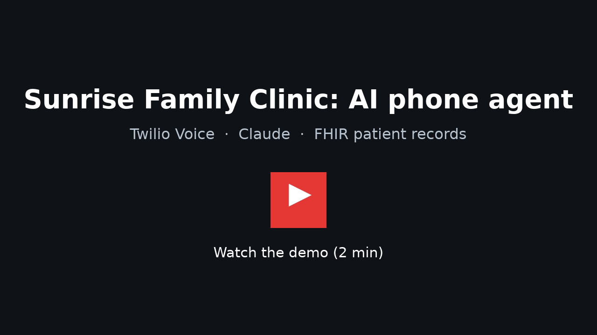
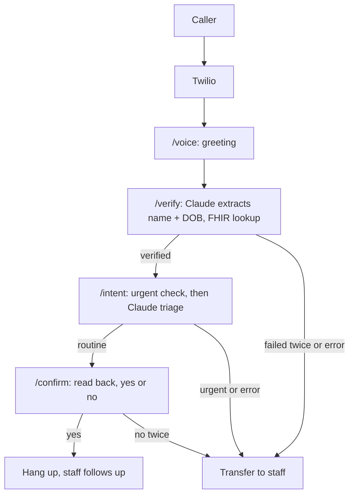

# Sunrise Family Clinic Voice Agent

A phone agent for a fictional clinic. A caller dials a Twilio number, says
their name and date of birth, and the agent verifies them against a FHIR
server. Claude then classifies the request (refill, appointment, billing,
urgent, other), reads it back for confirmation, and ends the call. Urgent
calls are transferred to a person instead of being handled by the model.

Built with Node, Express, Twilio Voice (TwiML), the Anthropic API, and the
public HAPI FHIR test server.

## Demo

[](https://youtu.be/aYGwVPTqIp0)

Two calls: a routine refill request, and an urgent call that's sent to a
person before any AI is involved (about 2 minutes).

## How a call works




_One call from start to finish, as seen in ngrok (newest request first).
Every step returned 200 OK._

Steps:

1. **Greeting** (`/voice`) - Twilio calls this webhook when the phone rings.
   The agent greets the caller and asks for their first name, last name, and
   date of birth, then listens for speech.
2. **Verification** (`/verify`) - the transcript goes to Claude, which
   extracts `firstName`, `lastName`, and `birthDate` as JSON. If that
   succeeds, the app searches the FHIR server for a matching patient. A
   caller gets one retry on a failed match or empty response before being
   transferred. Any error from Claude or FHIR transfers immediately, no
   retry.
3. **Intent** (`/intent`) - once verified, the caller says what they need.
   Every transcript is checked against a list of urgent keywords before it
   ever reaches Claude. If it's not urgent, Claude classifies it into one of
   five categories and writes a one-sentence reply restating the request.
4. **Confirmation** (`/confirm`) - the agent reads the reply back and asks
   "Is that right?" A yes ends the call. A no sends the caller back to
   `/intent` to try again, up to the same retry limit.
5. **Urgent handling** - urgent keywords are checked on every caller
   response: at verification, triage, and confirmation. If either the
   keyword check or the model itself flags urgent, the caller is told to
   hang up and dial 911 if it's life threatening, then transferred to a
   person.
6. **Transfer** - if `TRANSFER_NUMBER` is set, the call is dialed to that
   number with a timeout, and the agent apologizes and hangs up if nobody
   answers. If it's not set, the agent says staff will call back and hangs
   up.

In manual testing over ngrok, verification (Claude plus the FHIR lookup)
took about 1.9 seconds, and triage (Claude only) took about 0.8 seconds.

## Safety design

The keyword check for urgent phrases runs at `/verify`, `/intent`, and
`/confirm`, on every caller response, before Claude ever sees it. A caller
who mentions something urgent at any point is routed to a person, without
waiting on a model call. The model can also flag a request urgent on its
own during triage, and that's treated the same way.

If Claude or the FHIR lookup fails, the caller is transferred right away.
The app doesn't mark someone verified, or read back a request, based on a
call that didn't succeed. Retries are capped too: one retry on a failed
name/DOB match or an unclear request, then a transfer, so there's no
open-ended loop of "I didn't catch that." `/intent` and `/confirm` both
check `call.verified` and redirect back to `/voice` if it isn't set, so
those routes can't be reached out of order.

Twilio requests go through `twilio.webhook({ protocol: 'https' })` on every
route, with `trust proxy` enabled so Express sees the real protocol behind
ngrok. `VALIDATE_TWILIO_SIGNATURE` defaults to `true`. Twilio's console
"Try out Voice" tool doesn't sign its requests, so validation has to be
turned off (`VALIDATE_TWILIO_SIGNATURE=false`) to test with it locally.
Requests from a normally configured Twilio number include a signature, and
the tests cover missing, forged, and valid signatures.

## Handling PHI

This is a demo against a public test FHIR server with fake patients, not a
real clinic. It's still built as if the data were real.

**What is logged.** `src/log.js` only ever writes an explicit allowlist of
fields: `callSid`, `stage`, `category`, `outcome`, `ms`, `error`, `status`.
Every log call goes through this function, so a field that isn't on the
list is silently dropped rather than logged by accident.

**What isn't logged.** The caller's name, date of birth, the raw speech
transcript, the FHIR patient ID, and the actual text Claude generates
(the reply read back to the caller) never appear in a log line.

**Call state cleanup.** Call state (verification status, attempt counts,
patient ID) lives in an in-memory `Map` keyed by `CallSid`, not a database.
It's cleared two ways: Twilio's `/status` webhook deletes the entry as soon
as the call reaches a terminal status (completed, busy, failed, no-answer,
canceled), and a sweeper checks every minute for anything older than 30
minutes and deletes it as a backstop, in case a status callback is ever
missed.

**What real production would add.** This demo does not need most of a real
PHI-handling setup because it runs against a public test server, but a
production version would need:

- Business associate agreements (BAAs) with every vendor in the call path -
  Twilio, Anthropic, hosting, and anything else that touches audio or
  transcripts.
- Encryption at rest for any persisted data, not just in-memory state.
- Access controls, so only specific roles can view call records or patient
  data.
- Audit logs separate from application logs, recording who accessed what
  patient data and when.
- Defined retention limits, with old records deleted on a schedule instead
  of kept indefinitely.
- A shared state store (such as Redis) instead of an in-memory `Map`, since
  the current approach only works for a single process and loses all call
  state on restart.

## Setup

Requires Node 18+, a Twilio account with a phone number, an Anthropic API
key, and ngrok (or another HTTPS tunnel).

1. Install dependencies:

   ```
   npm install
   ```

2. Copy the environment template and fill in real values:

   ```
   cp .env.example .env
   ```

   Set `ANTHROPIC_API_KEY`, `ANTHROPIC_MODEL`, `TWILIO_ACCOUNT_SID`,
   `TWILIO_AUTH_TOKEN`, and optionally `TRANSFER_NUMBER`. Leave
   `FHIR_BASE_URL` pointed at the public HAPI test server unless you're
   running your own.

3. Start ngrok and note the HTTPS URL it gives you:

   ```
   ngrok http 3000
   ```

   Set `PUBLIC_BASE_URL` in `.env` to that URL. The app builds every
   callback URL (the Gather `action`, the redirect back to `/voice`) from
   this value instead of a relative path, because relative URLs didn't
   resolve correctly when calls came in through Twilio's console "Try out
   Voice" tool.

4. Seed a test patient on the FHIR server:

   ```
   npm run seed
   ```

   This searches for Maria Garcia, born 1985-04-12, and only creates the
   record if she doesn't already exist. Safe to run more than once.

   The HAPI server is public. Never put real patient data on it.

5. Start the server:

   ```
   npm run dev
   ```

6. In the Twilio console, point the phone number's voice webhook at
   `<PUBLIC_BASE_URL>/voice` (HTTP POST) and its status callback at
   `<PUBLIC_BASE_URL>/status`.

7. Call the number. If you're testing with the console's "Try out Voice"
   tool instead of a real call, set `VALIDATE_TWILIO_SIGNATURE=false` first,
   since that tool doesn't sign its requests.

## Tests

```
npm test
```

44 tests across four files, run with Vitest:

- **`urgent.test.js`** - `isUrgent()` against a list of phrases that should
  and shouldn't trigger an urgent transfer (chest pain, can't breathe,
  bleeding, passed out, overdose, "this is an emergency", versus a refill
  request, a reschedule, a billing question, and empty input).
- **`yesno.test.js`** - `parseYesNo()` against clear yes/no phrasing and
  ambiguous input that should resolve to `unclear` rather than guessing.
- **`claude.test.js`** - `parseJson()` against clean JSON, JSON wrapped in
  code fences, and unparseable junk; `validateIdentity()` against complete,
  incomplete, and badly formatted input; `extractIdentity()` and
  `classifyIntent()` against a mocked Anthropic client, so these tests
  don't call the real API; `validateIntent()` falling back to `other` for a
  category the model wasn't supposed to return.
- **`flow.test.js`** - the full HTTP flow through the Express app, using
  supertest and fake `extractIdentity`/`findPatient`/`classifyIntent`
  functions injected through `createApp()`. Covers a routine call from
  greeting through confirmation and hangup, an urgent keyword transferring
  without ever calling Claude, a model-classified urgent category also
  transferring, a failed match retrying once before transfer, a FHIR
  outage transferring, a Claude failure during triage transferring, an
  unverified caller being redirected away from `/intent`, and Twilio
  signature enforcement (a missing signature returns 400, a forged one
  returns 403, a valid one returns 200).

## What I'd do next

- Cut the pause during verification (about 1.9 seconds) by streaming
  audio to a real-time transcription service and streaming the model's
  responses, instead of waiting for each step to finish.
- Support Spanish and other languages, detected from the caller's first
  response. Many patients calling a clinic aren't comfortable in English.
- Connect refill, appointment, and billing requests to something real
  instead of just telling the caller staff will follow up.
- Replace the in-memory call state `Map` with a shared store so the app can
  run as more than one process.
- Handle the case where a FHIR search returns more than one matching
  patient, instead of taking the first result in the bundle.
- Add the production PHI safeguards listed above (BAAs, encryption at
  rest, access controls, audit logs, retention limits).
- Turn the JSON log lines into an actual dashboard instead of reading raw
  output.
- Test against a real inbound call end to end as part of CI, not just the
  HTTP-level flow tests.
